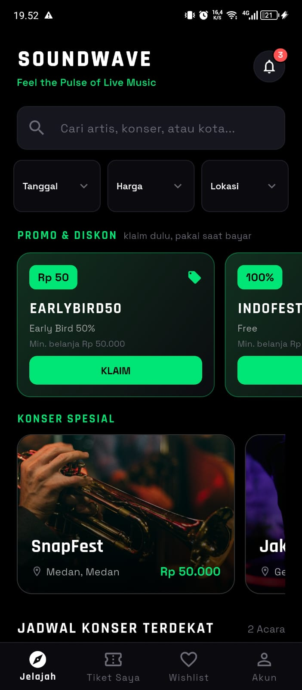
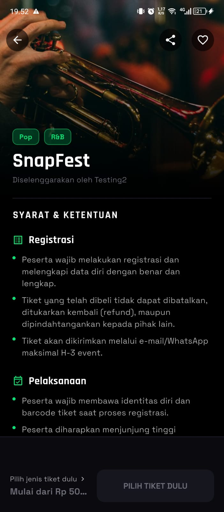
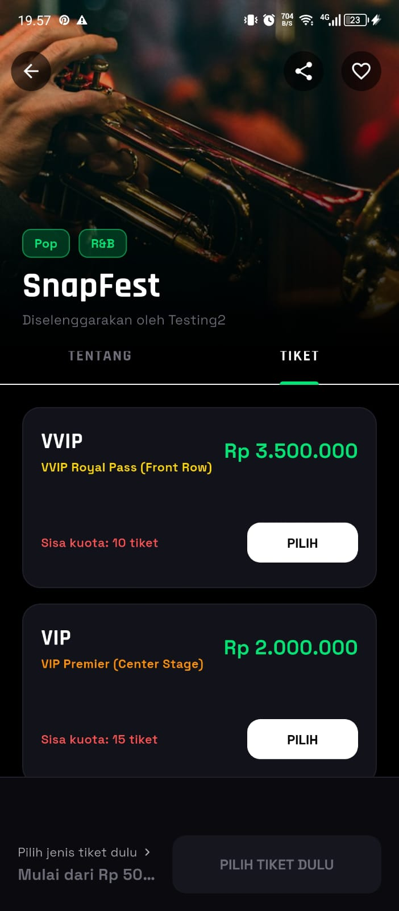
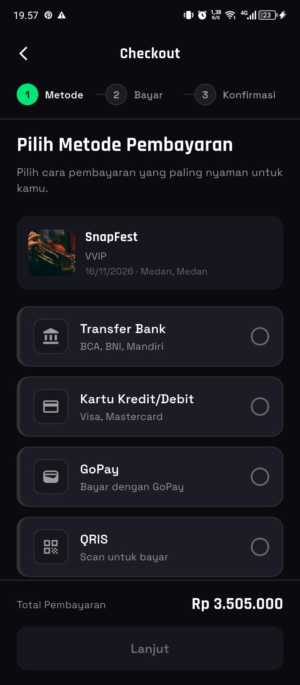
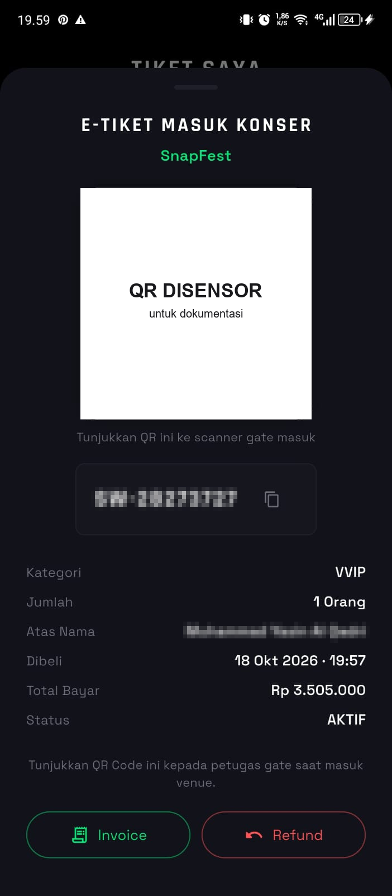
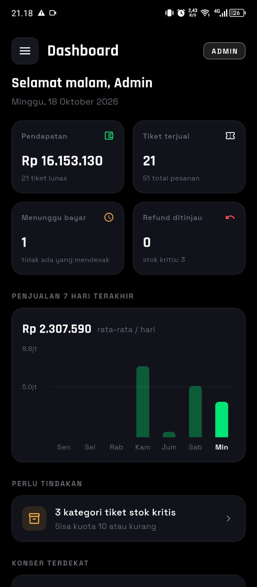
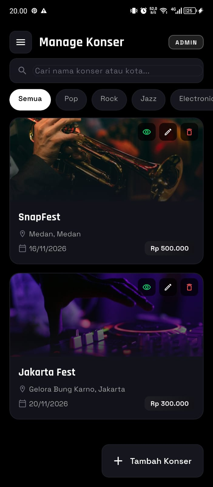
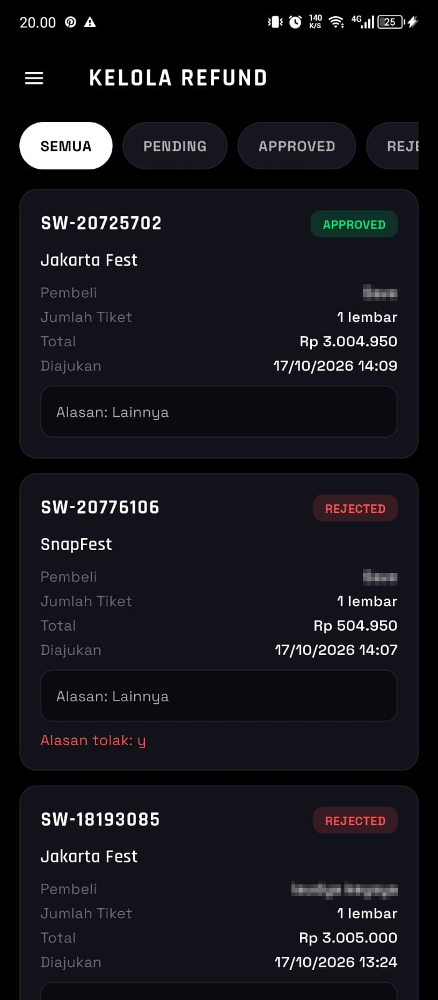
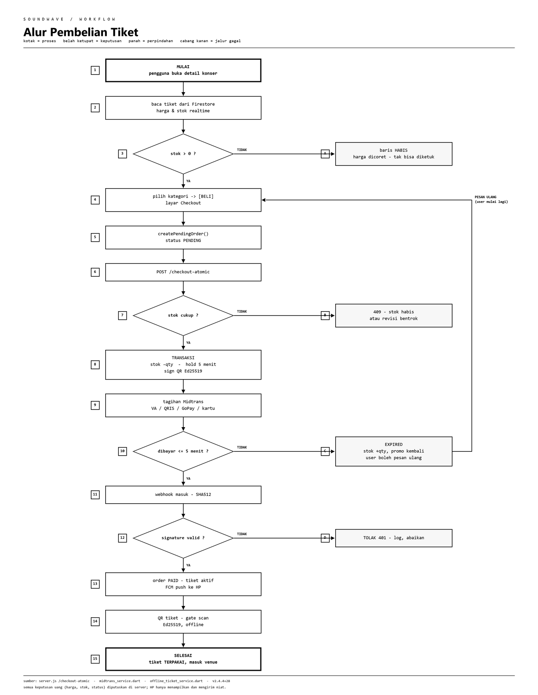
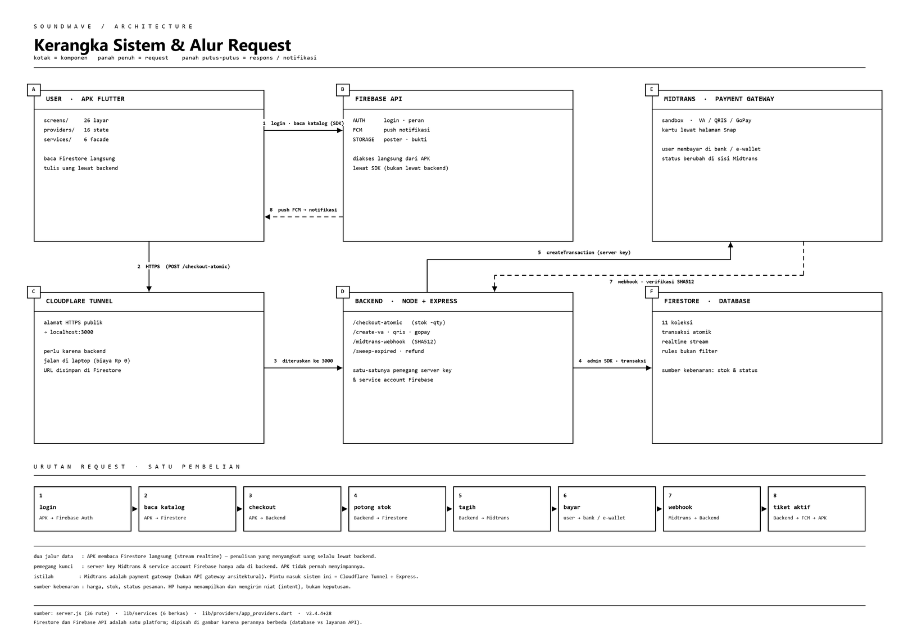

<div align="center">

# SoundWave

**Aplikasi pemesanan tiket konser musik. Flutter, Firebase, Midtrans.**

Berjalan penuh dengan biaya Rp 0: Firebase Spark, Midtrans Sandbox, dan Cloudflare Quick Tunnel.

[](https://flutter.dev)
[](https://dart.dev)
[](https://nodejs.org)
[](https://firebase.google.com)
[](https://midtrans.com)
[](#pengujian-dan-kualitas-kode)
[](#pengujian-dan-kualitas-kode)
[](#lisensi)

</div>

---

## Ringkasan

SoundWave punya dua sisi dalam satu aplikasi. Penonton mencari konser, memilih kategori tiket, membayar lewat Midtrans, lalu menyimpan tiket ber-QR di HP. Admin memakai panel di aplikasi yang sama untuk mengelola konser, kuota, promo, refund, dan memindai tiket di pintu masuk.

Waktu paling banyak habis di bagian yang mudah salah, terutama ketika dua orang membeli tiket yang sama pada detik yang sama:

- Harga dihitung ulang di server saat checkout. Angka kiriman klien diabaikan, dan kalau ada selisih permintaan ditolak.
- Stok dijaga transaksi Firestore dengan `revisionCounter` sebagai kunci optimistis. Yang kalah balapan menerima `409` lalu diminta mencoba lagi.
- Setiap pesanan membawa `orderId` idempoten, jadi retry jaringan tidak menghasilkan dua tagihan.
- Tiket ditandatangani Ed25519 di server dan diverifikasi di HP memakai public key per `keyId`. Verifikasi tidak bertanya ke server, sehingga gerbang tetap jalan saat sinyal di lokasi acara buruk.
- Reservasi 5 menit memakai `reservedUntil` dari jam server. Mengubah jam perangkat tidak memperpanjang pesanan.

Penjelasan teknis lengkapnya, dari rantai HTTP sampai mode kegagalan dan trade-off, ada di **[`docs/ARSITEKTUR_SISTEM.md`](docs/ARSITEKTUR_SISTEM.md)** (24 bab).

---

## English Summary

SoundWave is a two-sided concert ticketing system built with Flutter (Riverpod, Firebase) and a Node.js/Express backend. It runs at zero cost on the Firebase Spark plan, Midtrans Sandbox, and a Cloudflare quick tunnel.

The server owns the truth. Prices are recomputed at checkout, stock is guarded by a Firestore transaction with an optimistic `revisionCounter` lock, and every order carries an idempotent `orderId` so retries never double-charge. Payments are confirmed through a SHA512-verified Midtrans webhook, with polling as a fallback. Issued tickets are signed with Ed25519 and verified offline by the app, so gate scanning keeps working when the venue network does not. Reservations expire on a server-side five-minute clock, not the device clock.

Architecturally this is a layered monolith: Flutter feature-first UI over service facades, and an Express transaction-script backend acting as a BFF in front of Firestore and Midtrans. 319 automated tests, `flutter analyze` clean.

---

## Daftar Isi

- [Ringkasan](#ringkasan) · [English Summary](#english-summary)
- [Tangkapan Layar](#tangkapan-layar)
- [Fitur](#fitur)
- [Alur Pembelian Tiket](#alur-pembelian-tiket)
- [Arsitektur](#arsitektur)
- [Teknologi](#teknologi)
- [Struktur Proyek](#struktur-proyek)
- [Menjalankan Proyek](#menjalankan-proyek)
- [Konfigurasi](#konfigurasi)
- [Pengujian dan Kualitas Kode](#pengujian-dan-kualitas-kode)
- [Keamanan](#keamanan)
- [Batasan yang Diketahui](#batasan-yang-diketahui)
- [Roadmap](#roadmap)
- [Lisensi](#lisensi)

---

## Tangkapan Layar

<div align="center">

| | | |
|:---:|:---:|:---:|
|  |  |  |
| Jelajah konser | Detail konser | Pilih tiket |
|  |  |  |
| Checkout | Tiket dan QR | Dashboard admin |
|  |  | |
| Kelola konser | Kelola refund | |

</div>

Gambar diambil dari aplikasi 2.4.7 dengan data uji. QR pada tiket contoh sengaja ditutup, dan nama pembeli pada layar refund disensor.

---

## Fitur

### Sisi penonton

| Fitur | Keterangan |
|---|---|
| Jelajah konser | Daftar konser dengan pencarian, filter kategori, dan status penjualan |
| Detail konser | Jadwal, lokasi, lineup, dan kebijakan refund dalam dua tab: `TENTANG` dan `TIKET` |
| Pilih kategori tiket | Harga dan sisa kuota dibaca dari Firestore, bukan ditulis di UI |
| Checkout dua langkah | Pilih metode bayar, lalu konfirmasi. Setelah masuk langkah konfirmasi, metode tidak bisa diubah |
| Reservasi 5 menit | Stok dikunci sementara dengan jam server. Lewat batas, pesanan menjadi `EXPIRED` dan stok kembali |
| Pembayaran | Virtual Account, GoPay, dan QRIS lewat Midtrans Sandbox |
| Tiket ber-QR | Kode booking dan QR, bisa dibagikan, punya hitung mundur menuju hari-H |
| Mode offline | Tiket ditandatangani Ed25519 dan diverifikasi tanpa internet |
| Promo | Kode promo dengan kuota dan masa berlaku, diklaim per pengguna |
| Refund | Pengajuan refund dengan alasan, ditinjau admin, statusnya terlihat di sisi pengguna |
| Favorit dan notifikasi | Simpan konser favorit, plus notifikasi push dan lonceng in-app |

### Sisi admin

| Fitur | Keterangan |
|---|---|
| Dashboard | Halaman pertama setelah login: pendapatan, tiket terjual, pesanan menunggu bayar, refund yang perlu ditinjau, grafik 7 hari, daftar perlu tindakan, progres konser terdekat, dan jalan pintas ke Scan Gate |
| Kelola konser | Tambah, ubah, hapus konser beserta poster dan detail acara |
| Kelola tiket | Kategori, harga, kuota, dan pembukuan stok per kategori |
| Kelola promo | Kode diskon, nominal, kuota, dan masa berlaku |
| Kelola refund | Tinjau, setujui, atau tolak pengajuan refund |
| Laporan | Laporan penjualan dan pendapatan dengan filter |
| Pemindaian gerbang | Scanner QR dengan verifikasi tanda tangan tiket dan pencatatan pindai |
| Manajemen pengguna | Daftar pengguna dan perannya |
| Inspeksi konser | Pemeriksaan data konser langsung dari panel |

---

## Alur Pembelian Tiket

<p align="center">
  
</p>

1. Penonton memilih kategori tiket. Aplikasi meminta reservasi ke backend, bukan memotong stok sendiri.
2. Backend menghitung ulang harga dari Firestore, memeriksa kuota, lalu menulis pesanan `RESERVED` di dalam transaksi dengan `revisionCounter`.
3. Aplikasi membuka halaman pembayaran Midtrans Snap sesuai metode yang dipilih.
4. Pembayaran dikonfirmasi lewat webhook yang signature SHA512-nya diverifikasi, dengan polling sebagai cadangan bila webhook terlambat.
5. Setelah lunas, server menerbitkan tiket: kode booking dan tanda tangan Ed25519. Status pesanan menjadi `AKTIF`.
6. Tiket tampil di aplikasi dan bisa dipindai di gerbang, online maupun offline.

Empat cabang gagal ditangani eksplisit: stok habis (ditolak di UI sebelum request dikirim), balapan stok (`409`, pengguna diminta ulang), reservasi kedaluwarsa (`EXPIRED`, pesan ulang), dan webhook tidak sah (`401`, status pesanan tidak berubah).

---

## Arsitektur

<p align="center">
  
</p>

Layered monolith dengan client-server tiga lapis.

| Lapis | Isi | Tanggung jawab |
|---|---|---|
| Klien | Flutter + Riverpod | Tampilan dan state. Bukan sumber kebenaran harga maupun stok |
| Backend | Node.js + Express (`server.js`, 26 rute) | BFF: hitung ulang harga, transaksi stok, webhook, penerbitan tiket, pemindaian |
| Data | Firestore + Firebase Auth + Storage | Dokumen, identitas, poster konser |

Prinsip yang dipegang:

- Harga, stok, dan status pesanan hanya berubah di server.
- Widget tidak memanggil Firestore langsung. Semua lewat service facade (`database_service`, `midtrans_service`, `auth_service`, dan seterusnya) yang diakses lewat provider.
- Perubahan stok memakai transaksi Firestore dengan kunci optimistis, bukan tulis biasa.
- `orderId` dibuat idempoten supaya retry tidak menagih dua kali.
- Tanda tangan tiket diverifikasi dengan public key, bukan dengan bertanya ke server.

Microservices tidak dipakai di sini. Bebannya satu kampus, satu tim, satu database; memecah layanan hanya menambah latensi jaringan, biaya operasional, dan langkah deploy. Perbandingan lengkap beserta trade-off-nya ada di [`docs/ARSITEKTUR_SISTEM.md`](docs/ARSITEKTUR_SISTEM.md).

---

## Teknologi

**Aplikasi (Flutter)**

| Kebutuhan | Pilihan |
|---|---|
| State dan DI | `flutter_riverpod` (16 provider) |
| Backend-as-a-service | `firebase_core`, `cloud_firestore`, `firebase_auth`, `firebase_storage`, `firebase_messaging` |
| Pembayaran | Midtrans Snap lewat backend (HTTP) |
| QR dan pemindaian | `qr_flutter`, `mobile_scanner` |
| Tanda tangan tiket | `cryptography` (Ed25519) |
| Grafik | `fl_chart` |
| Notifikasi lokal | `flutter_local_notifications`, `timezone` |
| Lain-lain | `google_fonts`, `cached_network_image`, `shimmer`, `image_picker`, `share_plus`, `url_launcher`, `intl` |

**Backend (Node.js)**

| Kebutuhan | Pilihan |
|---|---|
| HTTP | `express` |
| Database | `firebase-admin` (Firestore) |
| Pembayaran | `midtrans-client` |
| Konfigurasi | `dotenv` |
| Eksposur lokal | Cloudflare Quick Tunnel (`cloudflared`) |

**Platform**

- Package `com.example.soundwave`, minSdk 24, targetSdk 36
- Versi saat ini 2.4.7+31
- Tema gelap: latar `#000000`, aksen harga `#00E676`, font Rajdhani dan Space Grotesk

---

## Struktur Proyek

```
Soundwave/
├── lib/
│   ├── constants/        app_constants.dart, satu tempat untuk konstanta global
│   ├── models/           9 model data (konser, tiket, pesanan, promo, refund, ...)
│   ├── providers/        app_providers.dart, 16 provider Riverpod
│   ├── services/         6 service facade (database, auth, midtrans, notifikasi,
│   │                     storage, tiket offline)
│   ├── screens/
│   │   ├── auth/         login, register
│   │   ├── user/         jelajah, detail, checkout, tiket, invoice, favorit, promo
│   │   └── admin/        dashboard, kelola konser/tiket/promo/refund, laporan,
│   │                     scanner gerbang, manajemen pengguna
│   ├── widgets/          komponen dipakai ulang (kotak pending, dialog sejajar, ...)
│   ├── utils/            tema, hitung mundur, helper rundown, urutan tiket
│   └── main.dart
├── test/                 319 test (unit + widget)
├── docs/                 arsitektur, workflow, kerangka sistem, screenshot
├── android/ · ios/ · web/ · windows/ · linux/ · macos/
└── pubspec.yaml
```

Arah ketergantungan selalu satu arah:

```
screens  →  providers  →  services  →  models
```

Model tidak tahu soal UI, dan layar tidak tahu soal Firestore.

---

## Menjalankan Proyek

### Prasyarat

- Flutter 3.x (Dart ≥ 3.0)
- Node.js ≥ 18
- Proyek Firebase dengan Firestore, Auth, Storage, dan Cloud Messaging aktif
- Akun Midtrans Sandbox (server key dan client key)
- `cloudflared`, sudah disertakan di repo backend

### 1. Backend

```bash
git clone https://github.com/ysnalqdr/soundwave-backend.git
cd soundwave-backend
npm install
# isi .env (lihat tabel Konfigurasi), lalu letakkan serviceAccountKey.json
npm start
```

Backend berjalan di `http://localhost:3000`. Untuk diakses dari HP, jalankan tunnel:

```bash
node start_tunnel.js
```

URL tunnel yang didapat disimpan ke Firestore (`events/_backend_config`), jadi aplikasi otomatis memakai alamat terbaru tanpa perlu build ulang.

### 2. Aplikasi

```bash
git clone https://github.com/ysnalqdr/soundwave.git
cd soundwave
flutter pub get
flutter run
```

Build APK:

```bash
flutter build apk --debug
# hasil: build/app/outputs/flutter-apk/app-debug.apk
```

### 3. Catatan Midtrans Sandbox

- Pakai server key dan client key Sandbox, bukan Production.
- Untuk QRIS, jangan isi `qris.acquirer`. Sandbox menolak `gpn` dengan HTTP 500.
- Webhook butuh URL publik, dan itu alasan tunnel dipakai saat pengujian lokal.

---

## Konfigurasi

Nilai rahasia tidak ditulis di repo. Semuanya lewat `.env` yang sudah masuk `.gitignore`.

**Backend, `soundwave-backend/.env`**

| Variabel | Kegunaan |
|---|---|
| `MIDTRANS_SERVER_KEY` | Server key Sandbox untuk membuat transaksi dan memverifikasi webhook |
| `MIDTRANS_CLIENT_KEY` | Client key Sandbox untuk Snap |
| `MIDTRANS_IS_PRODUCTION` | `false` untuk Sandbox |
| `PORT` | Port backend, default `3000` |
| `FIREBASE_SERVICE_ACCOUNT` | Path ke `serviceAccountKey.json` |

**Aplikasi, `Soundwave/.env`**

| Variabel | Kegunaan |
|---|---|
| `MIDTRANS_CLIENT_KEY` | Client key Sandbox, hanya untuk Snap |
| `BACKEND_BASE_URL` | Alamat backend atau tunnel untuk pengembangan lokal |

> `.env`, `serviceAccountKey.json`, `node_modules/`, dan `build/` tidak ikut ter-commit. Kalau salah satunya pernah terlanjur masuk, rotate key-nya sebelum push berikutnya.

---

## Pengujian dan Kualitas Kode

```bash
flutter analyze     # No issues found!
flutter test        # 319 test lulus
```

Test-nya tidak berhenti di "apakah widget tampil". Yang dijaga adalah aturan bisnis yang paling mudah rusak:

- harga dan stok yang tampil harus berasal dari data tiket asli;
- pesanan `RESERVED` dan `PENDING` dianggap menunggu bayar, dan kedaluwarsa dihitung dari `reservedUntil` dengan fallback 24 jam untuk data lama;
- tombol bayar baru aktif setelah kategori dipilih, dan satu-satunya pintu ke checkout adalah tombol di bar bawah;
- tombol dialog aksi tetap sejajar kiri-kanan sampai lebar layar 240 px;
- angka dashboard dihitung dengan definisi yang sama seperti laporan, sehingga tidak ada dua versi kebenaran;
- versi di `app_constants.dart` harus sama dengan `pubspec.yaml`, dan test gagal kalau keduanya melenceng;
- fitur yang dihapus ikut menghapus test dan pemanggilnya, jadi tidak ada kode mati yang tertinggal.

CI menjalankan `flutter analyze` dan `flutter test` pada setiap push ke `main` atau `master` (`.github/workflows/flutter_ci.yml`).

---

## Keamanan

| Area | Penanganan |
|---|---|
| Webhook pembayaran | Signature SHA512 diverifikasi. Permintaan tanpa signature sah ditolak `401` |
| Harga dan stok | Dihitung ulang di server. Nilai kiriman klien diabaikan |
| Balapan stok | Transaksi Firestore dengan `revisionCounter` (optimistic concurrency) |
| Pembayaran ganda | `orderId` idempoten |
| Tiket palsu | Tanda tangan Ed25519, diverifikasi offline dengan public key per `keyId` |
| Pemindaian ganda | Ledger lokal dan `/sync-offline-scans` mencegah satu tiket masuk dua kali |
| Rahasia | `.env` dan `serviceAccountKey.json` tidak masuk repo. Key Sandbox hanya untuk demo |
| Akses data | Firestore Security Rules sebagai lapisan kedua. Rules bukan filter, jadi query tetap harus dibatasi di klien |

---

## Batasan yang Diketahui

Proyek ini disiapkan untuk demo dan tugas kampus, jadi beberapa hal saya biarkan apa adanya:

1. **Tidak ada nomor kursi.** Stok dihitung per kategori. Fitur denah dan pilih kursi sudah dihapus karena tidak pernah benar-benar mengunci kursi.
2. **Backend berjalan di laptop.** Cloudflare Quick Tunnel memberi URL acak setiap kali start, sehingga alamat backend disimpan di Firestore dan bisa berubah.
3. **Firebase Spark punya kuota harian** (20.000 tulis, 50.000 baca). Cukup untuk demo, tidak untuk produksi.
4. **Sandbox, bukan uang nyata.** Tidak ada settlement dan tidak ada rekonsiliasi bank.
5. **Autentikasi rute backend belum diperketat.** Beberapa rute masih mengandalkan ID kiriman klien. Ini butuh verifikasi token Firebase sebelum dipakai di produksi.
6. **Beberapa nilai masih hardcode.** Biaya layanan Rp 5.000 muncul di tujuh tempat di backend dan satu di aplikasi, kandidat kuat untuk dipindah ke satu konfigurasi.

---

## Roadmap

- [ ] Verifikasi Firebase ID token di seluruh rute backend
- [ ] Sentralisasi biaya layanan dan daftar kategori ke satu sumber konfigurasi
- [ ] Nomor kursi asli dengan penguncian per kursi, kalau memang dibutuhkan
- [ ] Rekonsiliasi otomatis untuk refund yang tertunda
- [ ] Mode produksi: Midtrans Production, Firebase Blaze, dan backend ter-hosting

---

## Lisensi

Dirilis di bawah MIT License. Bebas dipakai, diubah, dan dibagikan asal atribusinya tetap dicantumkan.

Repo ini dikelola sendiri. Laporan bug lewat Issues tetap diterima, tapi pull request dari luar belum tentu cepat ditinjau.

Dibuat sebagai proyek pembelajaran rekayasa perangkat lunak: satu aplikasi, satu backend, tanpa biaya operasional.
